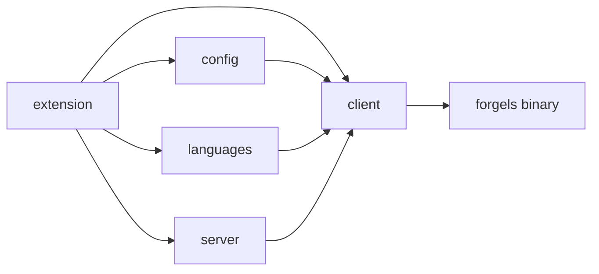

# Architecture

Scope: forgels-vscode extension. VSCode LSP client for the forgels server binary. Beta is solidity only.

## Layout

```text
src/
  extension.ts   # activate, deactivate
  client.ts      # LanguageClient start, stop, restart
  config.ts      # forgels.* settings with defaults
  languages.ts   # language id and extension table
  server.ts      # binary resolve and spawn options
```



## Modules

- `extension.ts`: registers activate and deactivate. No client logic. Calls `client.start` on matching documents. Calls `client.stop` on deactivate.
- `config.ts`: reads `forgels.serverPath`, `forgels.trace`, `forgels.enableSolidity`, plus future `enableCairo`, `enableNoir`, `enableMove`. Returns typed object with defaults. No VSCode API outside this module except `workspace.getConfiguration`.
- `languages.ts`: single language table. Maps id to extensions and enable flag. Exposes `getDocumentSelector` and `isBetaEnabled`. No hardcoded ids in other modules.
- `server.ts`: resolves binary path. Order: `forgels.serverPath` setting, then bundled `bin/forgels`, then `PATH`. Returns command plus args plus stdio options. No spawn here except through `ServerOptions`.
- `client.ts`: builds `LanguageClient` with id `forgels`, stdio `ServerOptions`, `LanguageClientOptions` with document selector, output channel, and restart on config change. Exposes `start`, `stop`, `restart`. Single place to change transport later.

## Runtime Flow

1. User opens `.sol` file.
2. `extension.activate` reads config and language table.
3. `server.resolve` returns binary command.
4. `client.start` spawns `forgels` over stdio and sends `initialize`.
5. Server publishes `textDocument/publishDiagnostics`. Client renders them.
6. On `forgels.*` config change, client restarts once.

## Config Keys

- `forgels.serverPath`: string, empty means auto resolve. Scope: machine.
- `forgels.trace`: `off`, `messages`, `verbose`. Default `off`.
- `forgels.enableSolidity`: bool. Default true.
- `forgels.enableCairo`, `forgels.enableNoir`, `forgels.enableMove`: bool. Default false. Reserved for later.

## Language Table

```text
solidity: .sol, beta active
cairo:    .cairo, gated off
noir:     .nr, gated off
move:     .move, gated off
```

- Selector derives from this table plus enable flags.
- New language means one row here plus one config flag plus docs update. No other call site changes.

## Server Contract

- Binary name: `forgels`.
- Transport: stdio only.
- Server languages: `solidity` now, `noir` stub, `cairo` and `move` planned.
- Client must ignore files the server does not support. Gate by table before start.

## Future Extension Points

- Lint: new module `src/lint.ts` with commands only. No logic shared with `client.ts` except config read.
- Format: new module `src/format.ts` behind `forgels.enableFormat`. Disabled by default until server supports it.
- New transport: change only `client.ts` plus `server.ts` options. Keep `extension.ts` stable.

## Non Goals

- No grammar. No parser. No AST. No analysis. No diagnostics transform.
- No bundled server logic. No duplicate routing. Routing lives in `forgels-core`, mirrored read only in `languages.ts`.
